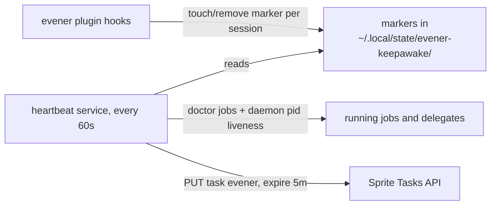

# evener-keepawake

Keeps a Fly.io Sprite awake while evener is working, so closing the browser
tab no longer freezes sessions mid-turn. Running processes and Sprite services
do **not** keep a Sprite awake — only the Sprite Tasks API does — so this
repo pairs an evener plugin (which records when sessions are busy) with a
heartbeat service (which holds the `evener` task while anything is busy).

## How it works



- The plugin's hooks fire synchronously inside every session (hub, CLI, and
  delegate children all load it once installed). They touch or remove one
  marker file per session — no network, one file operation per event.
- Busy events: `SessionStart`, `UserPromptSubmit`, `PostToolBatch`,
  `SubagentStart`, and `PostToolUseFailure(AskUserQuestion)`.
- Idle events: `Stop`, `StopFailure`, `SubagentStop`, `SessionEnd`, and
  `PreToolUse(AskUserQuestion)` — when a turn ends on a pending question
  evener skips `Stop` entirely, so the marker must be cleared when the
  question is asked.
- `Stop` fires even while background shell jobs are still live, and hook
  inputs carry no job state, so the heartbeat independently detects running
  work: it lists live session daemons from the evener run dir
  (`~/.local/state/evener/run/*.json`), asks `evener doctor jobs` about each,
  and only trusts a `running` job or delegate when the owning daemon's pid is
  still alive. A crashed session therefore never holds the Sprite awake.
- A marker untouched for 55 minutes is stale and ignored (task expire is 5m,
  so a killed session lets the Sprite sleep within about an hour).

## Configuration

Machine-specific values live in one optional shared config file,
`~/.config/evener-sprite/config` (override its location with
`EVENER_SPRITE_CONFIG`), never committed. Precedence: per-tool env var >
config file > neutral built-in default. `config.example` documents every key.
The one key this repo consumes:

| Key / per-tool env var | Meaning | Default |
|---|---|---|
| `LEGACY_CUTOFF` / `EVENER_KEEPAWAKE_LEGACY_CUTOFF` | pre-plugin-install cutoff ISO time; sessions started before it with recent transcript activity hold the Sprite | empty → the legacy source is disabled |

State and run dirs are env-var addressable (`EVENER_KEEPAWAKE_STATE`,
`EVENER_KEEPAWAKE_RUN_DIR`), defaulting to
`~/.local/state/evener-keepawake/` and `~/.local/state/evener/run`.

## Install

From this checkout:

```bash
evener plugin marketplace add --yes /path/to/evener-keepawake
evener plugin install --yes evener-keepawake@evener-keepawake
evener plugin list --effective        # must list evener-keepawake
```

Installed plugins are enabled by default and load into every session the hub
starts. A directory-source marketplace installs **in place**: the registered
plugin path is this checkout's `plugins/evener-keepawake/`, so edits here
take effect for every *new* session with no republish step. Already-running
sessions keep their loaded inventory.

Then register the heartbeat as a service (persists across reboots):

```bash
<your service manager> create evener-keepawake \
  --cmd /path/to/evener-keepawake/heartbeat/heartbeat.sh --no-stream
```

## Logs

- `~/.local/state/evener-keepawake/heartbeat.log` — the audit trail:
  - every busy beat names its reason (`refresh: marker <sid>` /
    `refresh: running job of session <sid>`), so a wrongly-awake Sprite
    always has a named culprit to chase;
  - every busy→idle transition logs the task release;
  - every ~15 min of idle logs `idle beat N [task=… markers=… live_daemons=…]`
    — `task=present` while idle means something else is holding a task;
  - every beat logs a `sample …` resource line: memory/swap/disk plus the
    cgroup counters Fly bills sprites on (`cpu_used_usec` cumulative CPU
    time, `mem_cg_kb` cgroup memory), so downstream reports can compute
    peaks and estimated Fly spend;
  - a frozen loop (Sprite pause, machine stall) logs
    `resumed after Ns gap (sprite pause or stall) …` on wake — that line is
    the sleep/wake record, since the whole service freezes with the Sprite;
  - service (re)starts log `heartbeat starting …` — repeated lines mean the
    service is crash-looping.
- `~/.local/state/evener-keepawake/hooks.log` — hook errors only (set
  `EVENER_KEEPAWAKE_DEBUG=1` in the session environment to log every event).

Reading a couple of days of `heartbeat.log` answers both audit questions:
"did we sleep?" — look for `resumed after …s gap` lines and long timestamp
jumps; "are we hung awake with nothing running?" — look for continuous
`refresh:` lines, whose reason names the marker or session holding the task
(a stale marker self-expires after 55 min; a dead daemon's "running" job is
filtered by pid liveness; a genuinely hung-but-alive delegate run would
legitimately hold the Sprite awake and show as
`refresh: running delegate of session <sid>` — investigate that session with
`evener doctor jobs <sid>`).

## Verify

1. Busy while working: start a task, `ls ~/.local/state/evener-keepawake/`
   shows a `<session_id>` marker, and
   `curl --unix-socket /.sprite/api.sock http://sprite/v1/tasks` lists `evener`.
2. Sleep after finish: when the turn ends the marker is removed, the task is
   deleted (or expires within ~6 minutes), and the Sprite can sleep.
3. Crash safety: kill a session mid-turn and no task remains after ~1 hour.

A single beat can be tested without the service loop:

```bash
heartbeat/heartbeat.sh --once
bash test/run.sh    # stub-based test suite (temp state, stubbed curl/evener)
```

## Known limits

- Sessions started **before the plugin was installed** never write markers.
  The heartbeat can bridge them: set `LEGACY_CUTOFF` to the plugin's install
  moment and a pre-install session with transcript activity in the last ~4
  minutes holds the machine (their background jobs were already covered by
  the live-daemon check). The bridge retires as pre-install sessions are
  restarted. The permanent fix is to stop+resume such a session at a turn
  boundary — the resumed daemon loads the plugin. Default: disabled.
- Sessions started with a sandbox that forbids writes outside session scratch
  cannot write markers; the heartbeat's job detection still covers their
  background jobs, but a plain running turn in a sandboxed session is
  invisible.
- Detached processes (`mode="detached"`) are not managed jobs by design: no
  marker, no job record, invisible to the heartbeat.
- The heartbeat refreshes only while it runs; if the Sprite reboots, the
  service auto-restarts and the next beat re-creates the task if work is
  still live.
